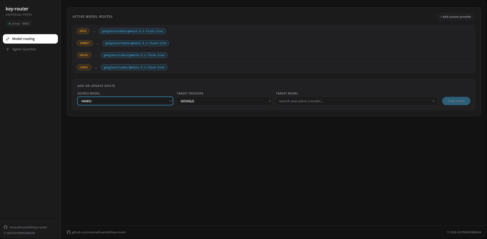

<div align="center">

  <h1>key-router</h1>
  <h3><strong>Claude Code + Codex — 1 key, universal proxy</strong></h3>

  <p>
    
    
    
    
    
    
    
    
  </p>

  <p>Local proxy that routes Claude Code and Codex to OpenRouter, DeepSeek, Google AI Studio or any OpenAI / Anthropic API — with full tool fidelity, thinking mode and streaming.</p>

  <p>
    <a href="#features">Features</a> •
    <a href="#tested-with">Tested with</a> •
    <a href="#quick-start">Quick Start</a> •
    <a href="#usage">Usage</a> •
    <a href="#configuration">Configuration</a> •
    <a href="#architecture">Architecture</a> •
    <a href="#project-structure">Project Structure</a> •
    <a href="CHANGELOG.md">Changelog</a>
  </p>

  <p>Language: <strong>English</strong> | <a href="#tiếng-việt">Tiếng Việt</a></p>

  <br/>

  
  <br/>
  <i>WebUI — Model routing, provider management, one-click launch</i>
  <br/><br/>
  
  <br/>
  <i>Claude Code routed through key-router to Google backend</i>
</div>

---

## Features

| Feature | Description |
| ------- | ----------- |
| **Claude Code + Codex** | `POST /v1/messages` (Claude), `POST /v1/chat/completions` + `POST /v1/responses` (Codex ≥0.149, `additional_tools` / `namespace` / `custom:exec`). |
| **Multi-provider routing** | OpenRouter, DeepSeek (V3/V4 thinking), Google AI Studio, or any OpenAI/Anthropic endpoint. Ingress-aware: Claude → Anthropic, Codex → OpenAI passthrough. |
| **Direct model addressing** | Any ingress accepts `<provider>/<model>` (built-in or custom provider ID) to call that provider directly, bypassing `config.json` routes. |
| **Thinking mode fixes** | DeepSeek V4 `reasoning_content` echo ([litellm#26395](https://github.com/BerriAI/litellm/issues/26395), [api-docs.deepseek.com/guides/thinking_mode](https://api-docs.deepseek.com/guides/thinking_mode/)) + Gemini `thoughtSignature` ([opencode#347](https://github.com/Gitlawb/openclaude/issues/347)). Multi-turn tool calls no longer 400. |
| **Full SSE streaming** | Token-by-token with Anthropic ↔ OpenAI translation and Responses typed events + agentic retry. |
| **Vision passthrough** | Pasted images from Codex (`input_image` → `image_url` data URLs) and Claude Code (`image` blocks) survive translation: base64/URL blocks for OpenAI-compatible providers, `inlineData` for Gemini. |
| **Skills manager** | Launcher → Skills: Installed/Browse, Claude Code/Codex split, global/project scope, real enable/disable, SKILL.md preview, install from skills.sh or a repo via `npx skills`. |
| **Custom providers** | Any OpenAI/Anthropic API via the **Providers** tab or `python -m cli add-provider`. One raw key per provider in `secrets.json`; the dashboard only sees masked previews. |
| **Settings & keys** | **Settings** tab: built-in/custom API keys and built-in base URLs stored in `secrets.json` (gitignored, `0600`), applied on the next request — no restart. |
| **Test lab** | Headless **Claude Code / Codex** runs with optional image input and a `provider/model` override that bypasses routing; checks image understanding, HTML/Markdown artifacts, OS/languages and the ≤10 shell budget. |
| **Personal tools** | **Tools** tab: install small tools from your own GitHub repos (or a local folder), start/stop each on a loopback port, and open its UI inside the dashboard. Tool credentials are configured in each tool's own Settings and stored in `secrets.json`; a Git workspace tool ships in `tools/git-tool`. |
| **IDE auto-detect & launch** | VS Code, VSCodium, Cursor — sets `~/.claude/settings.json`, `~/.codex/config.toml`, `disableLoginPrompt`. |
| **WebUI** | React + Tailwind dashboard: routing, providers, test lab, launcher, agents and settings. |
| **Agent bridge** | Run Claude Code as a **real agent** (edits files, runs commands) from any chat UI. A separate `agent-bridge` service exposes one OpenAI-compatible model, `key-router-agents`; driven by `/start` `/stop` `/agents` `/call`. Pasted images are forwarded to the CLI, agents can ask you questions with `ask_user`, and `/call` runs one-off sub-agents whose steps + result are handed to the main agent. Managed from the WebUI **Agents** tab. |
| **Cross-platform** | Windows / Linux / macOS. `start.sh` / `start.bat`, `dev.sh` / `dev.bat`. |

---

## Tested with

Last verified on **Arch Linux** (2026-11-04):

| Component | Version | Notes |
| --------- | ------- | ----- |
| Claude Code | **2.1.304** | CLI + VS Code extension (`--print --output-format stream-json`) |
| Codex | **0.149.0** | `codex exec`, Responses API |
| Open WebUI | **0.10.2** | Agent bridge (`:8083`) |
| Python | 3.11+ | |
| Node.js | 18+ · 22.20+ for Skills | |

Other versions may work. The Agent bridge depends on the CLI flags above; if a CLI renames them, update
`bridge/registry.py`. See [CHANGELOG.md](CHANGELOG.md) for what changed in 0.1.33.

---

## Quick Start

### Prerequisites

- **Python 3.11+** · **Node.js 18+** (Skills marketplace installs need **Node 22.20+**)
- API key for at least one provider: [OpenRouter](https://openrouter.ai/keys) · [DeepSeek](https://platform.deepseek.com/api_keys) · [Google AI Studio](https://aistudio.google.com)

> For the Claude Code VS Code extension, first install the CLI:
> ```bash
> npm install -g @anthropic-ai/claude-code
> ```

### 1. Install Claude Code & Codex

**Claude Code** (required for both CLI and VS Code extension):

```bash
# Node 18+ required
npm install -g @anthropic-ai/claude-code

# Verify — must print a version, not "command not found"
claude --version
# Also verify the native binary exists for the VS Code extension:
which claude   # Linux/macOS
where claude   # Windows — should point to claude.cmd
```

> The VS Code extension (`Anthropic Claude Code`) bundles its own CLI, but it requires the native `claude` binary to initialize. Without it the extension will fail even after proxy setup.

**Codex** (optional — for `gpt-5.6-sol`, `codex` etc.):

```bash
npm install -g @openai/codex
codex --version
# Codex authenticates via ~/.codex/config.toml — key-router writes it for you on launch.
```

### 2. Install key-router

```bash
git clone https://github.com/momadhuynh04/key-router.git
cd key-router

python -m venv venv
# Windows: venv\Scripts\activate
# Linux/macOS: source venv/bin/activate
pip install -r requirements.txt

cp .env.example .env   # optional — keys can also be set in the dashboard
```

**API keys** live in `secrets.json` (gitignored, written with owner-only permissions) and are managed
from the dashboard **Settings** tab. Add the key for each provider you use there — changes apply on the
next request, no restart. `.env` only holds process settings (`HOST`/`PORT`); it is not a key source.

### 3. Build WebUI

```bash
cd webui && npm install && npm run build && cd ..
# dev mode with HMR: ./dev.sh  (or dev.bat on Windows)
# In dev mode the frontend runs at http://localhost:5173
# while the backend stays at http://127.0.0.1:8082
```

### 4. Run

**Production** — single click, no auto-reload:

| Platform | Run | Stops with |
| -------- | --- | ---------- |
| Windows | `start.bat` | `Ctrl+C` |
| Linux / macOS | `./start.sh` | `Ctrl+C` |

What `./start.sh` / `start.bat` does: activates `venv`, runs `python -m cli.main` (uvicorn), waits for `:8082`, opens the browser.

**Manual** — same thing without the script:

```bash
# Activate venv first, then either:
uvicorn proxy.server:app --host 127.0.0.1 --port 8082
# or
python -m cli serve
# or directly
python -m cli.main   # no args → serves as well
```

**Development** — with hot-reload + HMR:

| Platform | Run | Backend | Frontend |
| -------- | --- | ------- | -------- |
| Windows | `dev.bat` | http://127.0.0.1:8082 (reload) | http://localhost:5173 (Vite) |
| Linux / macOS | `./dev.sh` | same | same |

`dev.sh`/`dev.bat` run `uvicorn --reload` and `npm run dev` in parallel.

After launch, open **http://127.0.0.1:8082** → continue to [Usage](#usage).

---

## Usage

### 1. Route models

**Model routing** tab → Source `Opus / Sonnet / Haiku / Codex` → Target provider → Target model → **Save route**. Persisted to `config.json`.

> Codex `gpt-5-codex` / `o3` / `codex` resolve via the `codex` family fallback. Set the **Codex** row to control the Codex backend.

### 2. Custom providers

**WebUI:** **Providers** tab → `+ Add provider` → ID (slug, `2-32` lowercase) → Display name → `OpenAI Compatible` or `Anthropic` → Base URL → API key (stored per provider ID in `secrets.json`) → Models. Expand a provider card to see its models, headers and routes; **Edit** reuses the same form with the ID locked, and **Fetch models** pulls the list from the provider's `/models` endpoint.

**CLI:**

```bash
python -m cli add-provider --id my --display-name "MyAI" --api openai_compatible --base-url https://api.my.ai/v1 --api-key "sk-..." --model my-model:"My Model"
python -m cli list-providers
python -m cli remove-provider my
python -m cli list-models my
```

`provider_api` selects the upstream protocol: `openai_compatible` calls `/chat/completions`,
`anthropic` calls `/v1/messages`. Models listed under `anthropic` must be supported by that
endpoint (DeepSeek/GLM models are usually OpenAI-only, so register those as OpenAI Compatible).
key-router normalizes Claude Code's newer beta fields (`role: "system"` messages,
`thinking.display`) but does not forward the client's `anthropic-beta` header — add it in the
provider's **Headers** field if an upstream requires a specific beta list.

`GET /api/custom-providers` only returns `has_key`, never the raw key. Deleting a provider is
blocked while a model route still targets it: `DELETE /api/custom-providers/<id>` returns `409`
with the offending routes, so repoint or remove them on **Model routing** first.

### 3. Settings

The **Settings** tab manages credentials and upstream endpoints:

- **Provider API keys** for OpenRouter, DeepSeek, Google AI Studio, plus one key per custom provider.
  The dashboard only ever receives a masked preview.
- **Base URLs** for the built-in providers. **Reset** restores the built-in default.

Keys and base URLs are read on every provider instantiation, so saving takes effect on the next
request — no proxy restart. `secrets.json` is gitignored and written atomically with `0600` on POSIX.

### 4. Test lab

**Test lab** runs one headless agent turn on **Claude Code** or **Codex** against a folder inside
`allowed_roots`, with an optional image. It verifies:

- the image was understood (vision test),
- `key-router-test.html` was written and looks like valid HTML,
- the agent found the host OS/machine information,
- it listed installed language toolchains,
- `key-router-review.md` reviews the HTML and mentions it,
- the run stayed within 10 shell commands.

The model field accepts `provider/model` (e.g. `openrouter/anthropic/claude-sonnet-4.5`,
`deepseekplatform/deepseek-flash`), which **bypasses Model routing** and calls that provider directly;
plain names use the current route. Artifacts go to `<workdir>/.key-router-testlab/<run-id>/`, steps
stream into the dashboard, and the last 20 runs are kept for comparison.

### 5. Personal tools

The **Tools** tab is an optional hub for your own small apps. Each tool is a separate GitHub repo
with a `tool.json` manifest (`id`, `name`, `start`, optional `setup`, `health`, `default_port`,
`env`). Register it with `POST /api/tools/install` (`owner/repo` or a local folder), then press **Start**:

- the package is downloaded from GitHub into `tools/<id>/` inside the key-router repo (100 MB cap, safe extract);
- starting it runs the manifest command on a free loopback port, with logs under `.key-router/logs/`;
- the tool UI opens in an iframe inside the dashboard; **Back** returns to the gallery;
- tools run until you stop them (SIGTERM → SIGKILL on the whole process group), and **Uninstall**
  removes the folder and registry entry;
- if a tool's folder disappears, its card shows **Reinstall** and downloads it again from the GitHub
  repo recorded in the registry (local installs read it from the git remote). Without a recorded
  repo, Reinstall asks for `owner/repo` once;
- `.key-router/tools.json` is **tracked** — it records each tool's source repo, so a fresh clone can
  list the tool and **Install** it. `runtime.json` (pid/session/port), logs and data stay gitignored.

**Credentials live in each tool's own Settings**, not on the Tools page. A manifest declares them
(`"GITHUB_TOKEN": "tool:github"`); key-router stores the value in `secrets.json` → `tool_keys` and
exposes it only to that tool, through a `X-Tool-Token`-protected endpoint scoped to the tool and its
current session. The tool UI reads back a masked preview, never the raw value. Each start also gets a
random session token (`?token=…`) that the tool's API middleware validates.

`tools/git-tool/` is the first tool: token status, a branch page (local branches above remote ones;
every remote branch compared against either the selected local branch or the repo's default branch —
ahead/behind, commits and changed files both ways — plus a lane-drawn commit/merge graph and
switching local branches), and GitHub pull requests and issues (list, detail, create, comment,
open/close). A **Workflow** tab runs the collaborator loop — checkout base → pull → new branch,
merge the base into a task branch, stage-all + commit, push — and ends by opening the pull request
for the branch it just pushed (there is no generic "create PR" form). **My pull requests** tracks
the PRs you opened (state, merged or not, link to GitHub) for everyone; owners additionally get a
**Pull requests** tab listing the whole repo, where each open PR can be merged
(merge commit / squash / rebase). **Issues & discussions** combines GitHub issues (state filters,
detail, comments, create, open/close) with repository discussions (read-only, linked to GitHub).
A single **Sync** button in the repo header runs `git fetch` and reloads every panel, so counts and
lists stop going stale between tabs. It can be registered from a local
folder while developing, and lives in its own repo when published.

**Repo discovery** in the Git tool is token-first: it lists every repo the token can see
(`owner`, `collaborator`, `organization_member`) and only then scans `allowed_roots` (depth 3) to
mark which of them have a local clone. Clones the token cannot reach are hidden; with no token (or an
empty result) the list falls back to the local scan. A GitHub repo is marked local when a matching
remote exists on this machine; otherwise it shows **“not found on this machine (or outside allowed
roots)”**. The sidebar has search,
All/Local/Remote/Pinned filters and pinning; scan roots, depth and refresh live in the tool's
Settings tab. Tool state (cache, pins, recent) is stored in `.key-router/data/<tool-id>/` (gitignored, inside the repo).

### 6. Launch

| Target | What it does |
| ------ | ------------ |
| **Claude Code (Terminal)** | Opens terminal with `ANTHROPIC_BASE_URL=http://127.0.0.1:8082` |
| **Codex** | Writes `~/.codex/config.toml` (`wire_api = "responses"`) and launches `codex` |
| **VS Code / VSCodium / Cursor** | Auto-detected via `PATH`, configures `~/.claude/settings.json` + IDE settings |

Then: `claude` · `codex` · or Spark icon in IDE.

> IDE not showing? Check `which code` / `where code` is in `PATH`, then run `detect-ide.sh` / `detect-ide.bat`.

### 7. Run agents from Open WebUI

`agent-bridge` lets a chat UI drive Claude Code as a real agent — it edits files and runs commands in a
chosen project folder. It is a **separate service** (default `:8083`) that you start from the WebUI
**Agents** tab. key-router itself still never spawns anything on its data path.

1. Dashboard → **Agents** → **Start bridge**.
2. Add agents: CLI, model, workdir, permission, effort, tools. Every `workdir` must live inside
   `allowed_roots` — that is the safety fence.
3. In Open WebUI: **Settings → Connections → OpenAI API** → URL `http://127.0.0.1:8083/v1`,
   key = the bridge token shown in the dashboard.
4. Set `ENABLE_FORWARD_USER_INFO_HEADERS=True` before Open WebUI starts, otherwise every chat
   shares one session:

   ```bash
   # Linux / macOS (start.sh)
   export ENABLE_FORWARD_USER_INFO_HEADERS=True
   open-webui serve
   ```

   ```bat
   REM Windows (start.bat / CMD)
   set ENABLE_FORWARD_USER_INFO_HEADERS=True
   open-webui serve
   ```

   PowerShell: `$env:ENABLE_FORWARD_USER_INFO_HEADERS="True"; open-webui serve`

   Docker: add `-e ENABLE_FORWARD_USER_INFO_HEADERS=True` (or the matching `environment:` entry).

Open WebUI sees exactly **one** model, `key-router-agents`. You pick the agent inside the chat:

| Command | Effect |
| ------- | ------ |
| `/agents` | List configured agents |
| `/start <id>` | Bind an agent to this chat and open a session |
| `/call <id> <prompt>` | Run a one-off sub-agent on this chat's history; the binding is untouched |
| `/stop` | Kill the running turn and unbind |
| anything else | Sent to the bound agent (`default_agent` is auto-started when nothing is bound) |

A `/call` (aliases `/sub`, `/run`) runs that agent in its own workdir with a text transcript of the chat
(last 80 messages, capped at 24k chars). It is not bound to the chat and does not touch the main
agent's session. When it finishes, its task, a compact list of tool steps, and its final result are
queued and injected as a `[Sub-agent handoff …]` block at the start of the main agent's next turn.
If the sub-agent calls `ask_user`, your next message continues that sub-agent's session, not the main one.

Tool calls, permission denials, cost and duration are rendered inline in the reply.

> If Open WebUI swallows messages that start with `/`, create Workspace → Prompts named
> `/agent-start`, `/agent-call`, `/agent-stop`, `/agent-list` with bodies
> `/start {{id}}`, `/call {{id}} {{task}}`, `/stop`, `/agents`.

**Permission** is per agent: `plan` (read-only), `edit` (`acceptEdits` — edits only inside the workdir),
`auto`, `ci` (`dontAsk`), `bypass` (only when `allow_bypass` is on; containers/VMs only). Headless runs
have no interactive prompt: anything that would ask is **denied instead**, and the denial is shown in the chat.

### 8. Manage skills

**Launcher → Skills** (no separate tab): choose **Claude Code** or **Codex**, then **Global** or
**Project**, and use **Installed** / **Browse**.

| Provider | Global | Project |
| -------- | ------ | ------- |
| Claude Code | `~/.claude/skills/<id>/SKILL.md` | `<project>/.claude/skills/<id>/SKILL.md` |
| Codex | `~/.agents/skills/<id>/SKILL.md` (+ `~/.codex/skills`) | `<project>/.agents/skills/<id>/SKILL.md` |

- **Browse** searches the public `skills.sh` index. **Install** writes to one or both providers in one
  step, using the official `npx skills ... --copy` flow.
- **Installed** shows user/project skills plus read-only system/plugin skills. Expand a row to preview
  `SKILL.md`; toggle to move the skill to `<root>/.disabled/` (the CLIs stop discovering it).
- Project scope is fenced by `allowed_roots` from `agents.json`. Add the project root in
  **Agents → Bridge settings → Safety fence → Allowed roots** (use **Browse folder** or type the
  path), then save. A folder outside those
  roots cannot be used for project scope — the panel lists the configured roots and how to fix it.
  Global scope writes only to the known provider roots above.
- Marketplace installs require **Node 22.20+** and `npx`. key-router copies files and **never executes**
  a skill; skills are third-party instructions/scripts with the agent's permissions — review before use.
- `npx skills` telemetry is disabled for installs; the CLI version is pinned to `skills@1.7.0`
  (override with `KEY_ROUTER_SKILLS_CLI`).

API: `GET /api/skills`, `GET /api/skills/marketplace`, `POST /api/skills/install`,
`POST /api/skills/toggle`, `DELETE /api/skills/{provider}/{scope}/{id}`,
`GET /api/skills/content`.

---

## Configuration

**`.env`** (process settings only):

| Variable | Required | Default |
| -------- | -------- | ------- |
| `HOST` / `PORT` | No | `127.0.0.1` / `8082` |

**secrets.json** (managed from **Settings**; gitignored, written with `0600`):

```json
{
  "keys": {"openrouter": "...", "deepseek": "...", "google": "..."},
  "custom_keys": {"<provider-id>": "..."},
  "base_urls": {"openrouter": "...", "deepseek_anthropic": "...", "deepseek_openai": "...", "google": "..."}
}
```

`secrets.json` is the **only** key source — there is no environment/`.env` fallback. Built-in base URLs
use hardcoded defaults unless overridden here. Keys and base URLs are read on every provider
instantiation, so Settings changes apply on the next request without restarting the proxy. The
dashboard only ever receives masked previews.

**config.json** (via WebUI):

```json
{
  "model_mappings": {
    "claude": "openrouter/anthropic/claude-sonnet-4-5",
    "codex": "deepseekplatform/deepseek-v4-flash"
  }
}
```

`claude` and `codex` are **family routes**: one key covers every model from that
family, so upstream renames (`opus`/`sonnet`/`haiku`/`fable`, `gpt-5.x`/`codex`/
`o4`…) keep working without editing config. Legacy per-tier keys (`opus`,
`sonnet`, `haiku`) still work as overrides and are merged into `claude`
automatically when the proxy starts (Sonnet's route is kept). An exact model key
(e.g. `claude-opus-4-1-20250805`) overrides the family route for that model only.

A requested model written as `<provider>/<model>` (built-in or custom provider ID, e.g.
`deepseekplatform/deepseek-flash`) bypasses these routes and calls that provider directly. The **Test
lab** uses this for its model override.

**agents.json** (via WebUI → Agents tab; `cp agents.example.json agents.json` to start from a template):

```json
{
  "port": 8083,
  "token": "<auto-generated on first run>",
  "allowed_roots": ["/mnt/Data/ProjectStorage"],
  "default_agent": "opus-probrowser",
  "max_concurrent_runs": 2,
  "turn_timeout_sec": 1800,
  "allow_bypass": false,
  "agents": [
    {
      "id": "opus-probrowser",
      "name": "Opus @probrowser",
      "cli": "claude",
      "model": "opus",
      "workdir": "/mnt/Data/ProjectStorage/probrowser",
      "permission": "edit",
      "effort": "high",
      "tools": "edit",
      "restricted": false,
      "add_dirs": [],
      "append_system_prompt": "",
      "fallback_model": "",
      "max_budget_usd": null,
      "allowed_tools": [],
      "disallowed_tools": []
    }
  ]
}
```

| Agent field | Maps to | Notes |
| ----------- | ------- | ----- |
| `model` | `--model` | A key from **Model routing**; the alias resolves through key-router |
| `permission` | `--permission-mode` | `plan` / `edit` / `auto` / `ci` / `bypass` |
| `effort` | `--effort` | `low` / `medium` / `high` / `xhigh` / `max` |
| `tools` | `--tools` | `readonly` / `edit` / `full` |
| `restricted` | `--restricted` | Drops the command-running tools; refuses `bypass` |
| `add_dirs` | `--add-dir` | Extra writable directories |
| `append_system_prompt` | `--append-system-prompt` | Project instructions for this agent |
| `fallback_model` | `--fallback-model` | Retry on another model when the primary is unavailable |
| `max_budget_usd` | `--max-budget-usd` | Hard spend cap per turn |
| `allowed_tools` | `--allowedTools` | Extra pre-approved patterns, e.g. `Bash(git *)` |
| `disallowed_tools` | `--disallowedTools` | Denied patterns; apply in every permission mode |

Every run also passes `--permission-prompts none`, so a headless turn never waits for a human: anything that would
prompt is denied, and the turn footer lists those denials as **Blocked by permissions**. This is why `permission: edit`
approves file edits but still denies Bash (`rg`, `find`, `git`); use `permission: auto` or add
`allowed_tools` patterns such as `Bash(rg:*)` when an agent needs shell commands.

Images pasted into the chat are forwarded to the CLI as image blocks. Those turns switch stdin to
`--input-format stream-json`; text-only turns keep the plain stdin path.

Claude Code's `AskUserQuestion` tool is not available under `-p`, so the bridge registers a small MCP
server (`bridge/mcp_ask.py`) that exposes `ask_user(question, options[])`. The turn renders the question
with numbered choices and then stops; the user's next message is framed as the answer
(`[User answered AskUserQuestion] …`) on the resumed session. The tool is pre-approved through
`--allowedTools`, otherwise headless mode would auto-deny it.

The bridge re-reads this file on every request, so dashboard changes apply immediately — no restart.

**Auto-config files on launch:**

| File | Sets |
| ---- | ---- |
| `~/.claude/settings.json` | `env.ANTHROPIC_BASE_URL` + `ANTHROPIC_API_KEY` |
| `~/.codex/config.toml` | `model_provider = "key-router"` |
| `~/.config/<IDE>/User/settings.json` | `claudeCode.disableLoginPrompt: true` |

---

## Development

```bash
./dev.sh              # backend :8082 (reload) + frontend :5173 (HMR)
python -m pytest test/ -v
```

| Test file | Focus |
| --------- | ----- |
| `test_ide.py` · `test_server.py` · `test_models.py` | IDE, server, pydantic |
| `test_openai_base.py` · `test_openai_stream.py` · `test_events.py` | Translation & SSE |
| `test_codex_ingress.py` · `test_codex_responses.py` | Chat + Responses ingress |
| `test_config.py` · `test_codex_config.py` | Mapper, codex config |
| `test_secrets.py` · `test_settings_api.py` | `secrets.json` store, Settings API |
| `test_custom_providers.py` · `test_testlab.py` | Provider CRUD, headless Test lab |
| `test_tools_*.py` | Personal tools: registry/manifest, install & safe extract, dashboard API |
| `test_openrouter.py` · `test_deepseek.py` | Adapters |
| `test_bridge_*.py` · `test_agents_api.py` | Agent bridge: directives, argv, SSE, API, dashboard CRUD |

393 tests, plus 72 for the git tool (`cd tools/git-tool && python -m pytest tests/`).

**Add a provider (code):** see [provider/CUSTOM_PROVIDER_GUIDE.md](provider/CUSTOM_PROVIDER_GUIDE.md) — inherit `OpenAIBaseProvider` or `BaseProvider`, register in `proxy/router.py`.

---

## Architecture

```
Claude Code  POST /v1/messages
Codex        POST /v1/responses  ─┐
Codex Chat   POST /v1/chat/completions ─┤→ proxy/app.py → routers/* → ModelMapper → ProviderRouter → provider
                                        └→ upstream (OpenRouter / DeepSeek V4 / Google / custom)
```

`proxy/server.py` is a thin `app = create_app()` — endpoints live in `proxy/routers/`.

## Project Structure

```
key-router/
├── proxy/            app, server, routers, ingress, errors, retry, testlab, tools_hub
├── provider/         base, openai_base, openrouter, deepseekplatform, googleaistudio, custom
├── models/           anthropic, openai_compat, events
├── config/           host/port, secrets, model_map, codex_config, custom_providers, skills, tools
├── bridge/           agent-bridge: OpenAI-compatible front for Claude Code / Codex
├── tools/git-tool/   personal tool sub-app (FastAPI + Vite UI)
├── webui/            React + Tailwind (App.tsx, SettingsPanel.tsx, TestLabPanel.tsx, ToolsPanel.tsx, …)
├── cli/              typer CLI (serve, add/list/remove provider)
├── test/             393 tests (+ tools/git-tool/tests)
└── start.sh / dev.sh
```

---

## Tiếng Việt

### Đã test với

Arch Linux · Claude Code **2.1.304** · Codex **0.149.0** · Open WebUI **0.10.2** · Python 3.11+ ·
Node 18+ (22.20+ cho Skills). Xem [CHANGELOG.md](CHANGELOG.md) để biết thay đổi của bản 0.1.33.

### Cài đặt

**1. Cài Claude Code & Codex**

```bash
npm install -g @anthropic-ai/claude-code   # bắt buộc — kể cả khi chỉ dùng extension VS Code
npm install -g @openai/codex               # nếu dùng Codex (gpt, codex...)
claude --version
codex --version
which claude   # Linux/macOS — kiểm tra binary có trong PATH
where claude   # Windows
```

> Extension VS Code `Anthropic Claude Code` cần binary `claude` native mới khởi động được — nếu thiếu, extension sẽ báo lỗi dù đã config proxy.

**2. Cài key-router**

```bash
git clone https://github.com/momadhuynh04/key-router.git
cd key-router

python -m venv venv
# Windows: venv\Scripts\activate
# Linux/macOS: source venv/bin/activate
pip install -r requirements.txt

cp .env.example .env
# API key nhập ở tab Settings (lưu secrets.json, áp dụng ngay không cần restart).
# .env chỉ chứa HOST/PORT, không chứa key.
```

**3. Build WebUI**

```bash
cd webui && npm install && npm run build && cd ..
# dev có hot-reload: ./dev.sh (Windows: dev.bat)
# dev chạy backend :8082 + frontend :5173 (Vite HMR)
```

**4. Chạy**

| Chế độ | Windows | Linux / macOS | Ghi chú |
| ------ | ------- | ------------- | ------- |
| **Production** | `start.bat` | `./start.sh` | Bấm là chạy, bấm `Ctrl+C` để dừng. Script tự kích hoạt venv, chạy `python -m cli.main`, đợi `:8082` rồi mở browser. |
| **Manual** | `venv\Scripts\activate` rồi `python -m cli serve` hoặc `uvicorn proxy.server:app --host 127.0.0.1 --port 8082` | `source venv/bin/activate` rồi tương tự | Cùng hiệu quả như script — dùng khi debug. |
| **Development** | `dev.bat` | `./dev.sh` | Chạy `uvicorn --reload` + `npm run dev` song song. |

Sau khi chạy, mở **http://127.0.0.1:8082**.

### Cấu hình

Vào tab **Model routing**: `Opus / Sonnet / Haiku / Codex` → chọn **Target provider** (OpenRouter / DeepSeek / Google / custom) → chọn **Target model** → **Save route**. Đã fix sẵn `reasoning_content` của DeepSeek V4 và `thoughtSignature` của Google nên không còn lỗi 400 khi gọi tool nhiều vòng.

Tab **Agent launcher**: **Claude Code** mở terminal đã set `ANTHROPIC_BASE_URL`, **Codex** tự ghi `~/.codex/config.toml`, **VS Code / Cursor / VSCodium** tự detect qua `PATH` — bấm là chạy.

**Test lab:** tab **Test lab** chạy 1 lượt agent headless trên **Claude Code** hoặc **Codex** trong thư mục thuộc `allowed_roots`, kèm ảnh nếu muốn. Nó tự kiểm tra: hiểu ảnh, tạo `key-router-test.html`, đọc OS/cấu hình máy, liệt kê ngôn ngữ đã cài, viết `key-router-review.md`, và giới hạn ≤10 lệnh shell. Ô model nhận `provider/model` (vd `deepseekplatform/deepseek-flash`) để **bỏ qua Model routing**; artifact nằm ở `<workdir>/.key-router-testlab/<run-id>/`.

**Tools (personal):** tab **Tools** để cài tool cá nhân từ GitHub của bạn. Mỗi tool là một repo riêng có `tool.json` (`start`, `setup`, `health`, `env`…). Tool đã đăng ký hiện trong tab; bấm **Install** (nếu chưa có folder) hoặc **Start**: key-router tải package vào `tools/<id>/` trong repo key-router, chạy command trên một port loopback, rồi nhúng UI của tool vào dashboard bằng iframe. Token (vd GitHub PAT) được nhập trong **Settings của chính tool** (không phải trang Tools), lưu ở `secrets.json` → `tool_keys`, và chỉ tool đang chạy đọc được qua endpoint có session token; mỗi lần start có session token riêng. Tool đầu tiên là **Git workspace** (`tools/git-tool/`): xem branch kèm ahead/behind và commit cuối, tạo/switch branch, xem/tạo/comment PR và issue. Dev có thể đăng ký thẳng thư mục local, không cần publish lên GitHub. Nếu xoá thư mục của tool, card hiện **Reinstall** và tải lại từ repo GitHub đã lưu trong registry (tool local tự đọc remote git); nếu chưa lưu repo thì Reinstall hỏi `owner/repo` một lần. `.key-router/tools.json` được **track trong git** (ghi repo nguồn để clone mới vẫn Install được); `runtime.json`, logs và data thì gitignored.

**Phát hiện repo** trong Git tool chạy 2 nguồn: liệt kê mọi repo mà token thấy (`owner` / `collaborator` / `organization_member`) và quét `allowed_roots` (depth 3) để tìm bản clone. Repo GitHub có clone trên máy được đánh dấu local; nếu không sẽ hiện **“not found on this machine (or outside allowed roots)”**. Sidebar có search, filter All/Local/Remote/Pinned và ghim repo; roots/depth và refresh nằm trong tab **Settings** của tool. State (cache/pin/recent) lưu ở `.key-router/data/<tool-id>/` (gitignored, ngay trong repo).

**Settings:** tab **Settings** quản lý API key cho OpenRouter / DeepSeek / Google và từng custom provider (lưu `secrets.json`, áp dụng ngay không cần restart; dashboard chỉ thấy preview) cùng Base URL của 3 provider builtin. `secrets.json` là nguồn key duy nhất.

**Custom provider:** vào tab **Providers** → **+ Add provider** → điền ID, Base URL (`https://api.xxx/v1`), API key (lưu theo provider ID trong `secrets.json`) → Models. Hoặc CLI `python -m cli add-provider ... --api-key "sk-..."` như bản tiếng Anh.

**Chạy agent từ Open WebUI:** vào tab **Agents** → **Start bridge** (service riêng, mặc định `:8083`; key-router không spawn gì trên đường dữ liệu). Thêm agent ngay trên UI: CLI, model, workdir, quyền, effort, tools — `workdir` bắt buộc nằm trong `allowed_roots`. Sau đó trong Open WebUI: **Settings → Connections → OpenAI API**, URL `http://127.0.0.1:8083/v1`, key là token hiện trong dashboard, và bật `ENABLE_FORWARD_USER_INFO_HEADERS=True` (native: `export ENABLE_FORWARD_USER_INFO_HEADERS=True` trong `start.sh` trước `open-webui serve`; Docker: thêm `-e` hoặc entry `environment:`).

Open WebUI chỉ thấy **đúng một model** `key-router-agents`. Chọn agent bằng lệnh trong chat:

| Lệnh | Tác dụng |
| ---- | -------- |
| `/agents` | Liệt kê agent đã cấu hình |
| `/start <id>` | Gắn agent vào chat này và mở phiên |
| `/call <id> <prompt>` | Chạy sub-agent một lần trên history của chat, không đổi agent đang gắn |
| `/stop` | Dừng lượt đang chạy và gỡ gắn kết |
| text thường | Gửi tới agent đang gắn (tự `/start default_agent` nếu chưa gắn) |

`/call` (alias `/sub`, `/run`) chạy agent đó trong workdir riêng với transcript text của chat (80 tin
gần nhất, tối đa 24k ký tự). Nó không bị gắn vào chat và không đụng session của agent chính. Khi xong,
task + danh sách tool steps + kết quả cuối được xếp hàng và chèn thành block `[Sub-agent handoff …]` ở
đầu lượt kế tiếp của agent chính. Nếu sub-agent gọi `ask_user`, tin nhắn tiếp theo của bạn sẽ tiếp tục
session của sub-agent đó.

Tool call, danh sách bị chặn quyền, cost và thời gian đều hiện ngay trong câu trả lời. Quyền đặt theo từng agent: `plan` (chỉ đọc), `edit` (sửa trong workdir), `auto`, `ci`, `bypass` (chỉ khi bật `allow_bypass`). Chạy headless không có prompt tương tác — thứ gì cần hỏi thì **bị từ chối luôn** và hiện lý do trong chat.

**Quản lý skills:** tab **Launcher → Skills** (không thêm tab mới). Chọn **Claude Code** hoặc **Codex**, phạm vi **Global** / **Project**, rồi **Installed** hoặc **Browse**. Browse tìm trên marketplace skills.sh; Install có thể ghi cho cả 2 provider bằng `npx skills --copy`. Project scope chỉ cho phép trong `allowed_roots` (thêm root ở **Agents → Bridge settings → Safety fence → Allowed roots** rồi Save; thư mục ngoài các root này sẽ bị chặn và panel hiển thị lý do cùng cách sửa). Nút toggle chuyển skill vào `<root>/.disabled/` để CLI thật sự không thấy; skill hệ thống/plugin/symlink là read-only. Cài marketplace cần **Node 22.20+** và `npx`; key-router chỉ copy file, **không chạy** skill — chỉ cài nguồn tin cậy.

**Gặp lỗi:** IDE không hiện → chạy `detect-ide.bat` / `./detect-ide.sh`, kiểm tra `where code` / `which code` có trong PATH không.

---

## License

MIT — see [LICENSE](LICENSE). © 2026 [huynhhoang04](https://github.com/momadhuynh04)

Release notes: [CHANGELOG.md](CHANGELOG.md).
